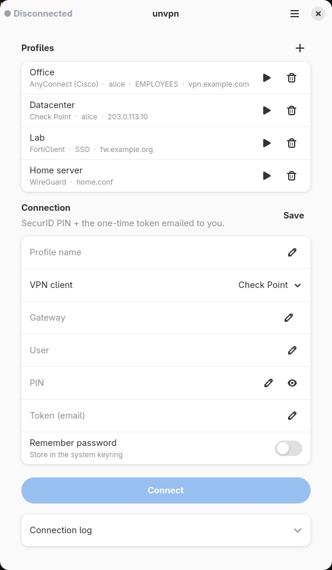

<div align="center">


# unvpn

A native Linux client for corporate VPNs.

</div>

unvpn speaks each VPN protocol itself. You don't need the vendor's client installed.

Supported VPNs:

- Check Point (Endpoint Connect / SNX, with RSA SecurID)
- Fortinet FortiGate SSL-VPN (password, OTP, SAML/SSO)
- F5 BIG-IP APM
- Cisco AnyConnect (password, 2FA, SAML/SSO)
- OpenVPN (`.ovpn` profiles)
- WireGuard (`wg-quick` `.conf` files)

It comes with a GTK app (saved profiles, passwords in the system keyring, tray icon) and a
command-line tool.

<p align="center">
  
  &nbsp;
  
</p>

## Install

You need Rust, a C compiler, `perl`, `make`, GTK4, libadwaita, `pkexec` and `iproute2`.
For the built-in SSO sign-in window, also install `webkitgtk-6.0`.

```sh
./install.sh                    # installs to /usr/local (asks for sudo)
PREFIX=~/.local ./install.sh    # or just for your user
./install.sh --uninstall
```

Then open **unvpn** from your app menu.

## Command line

```sh
sudo unvpn ike -g 203.0.113.10 -u alice --connect                # Check Point
sudo unvpn forti -g vpn.example.com -u alice --connect           # Fortinet
sudo unvpn f5 -g vpn.example.com -u alice --connect              # F5
sudo unvpn anyconnect -g https://vpn.example.com -u alice --connect
sudo unvpn openvpn -c profile.ovpn --connect
sudo unvpn wireguard -c wg0.conf --connect
```

Passwords are read from stdin. Run `unvpn` with no arguments to see all options.

## Legal

Only use unvpn to connect to VPNs you are allowed to use.
