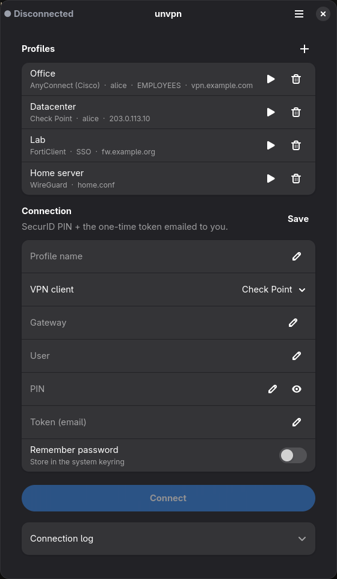

<div align="center">


# unvpn

A native Linux client for corporate VPNs, written in Rust.

</div>

Supported VPNs:

- Check Point
- Fortinet FortiGate SSL-VPN
- Fortinet FortiClient IPsec (IKEv2 + EAP)
- F5 BIG-IP APM
- Cisco AnyConnect
- Palo Alto GlobalProtect
- OpenVPN
- WireGuard

<p align="center">
  
</p>

## Features

- GTK4 app with saved connection profiles; passwords in the system keyring. The
  same profiles connect from the command line (`unvpn connect <profile>`).
- Tray icon showing the connection state.
- Several VPNs at once: each connection has its own row in the app and its own
  entry in the tray, and starting one leaves the others up.
- Desktop notifications while the window is in the background: a connection
  came up, dropped (after a few seconds of reconnecting), came back, or failed —
  with a button to connect it again.
- A connection outlives the app: closing or restarting it leaves the tunnel up,
  and the app (or `unvpn status` / `unvpn disconnect`) picks it up again. **Quit**
  disconnects.
- Encrypted export / import of all profiles, to move them between machines.
- Auto-reconnect after sleep or a network change, without re-auth.
- Leak protection: optional kill switch and an IPv6 egress block.
- Split DNS: with systemd-resolved, a tunnel's DNS servers go on its own link and
  answer only for its domains (all names for a full tunnel); without it,
  `/etc/resolv.conf` points at them while connected (`UNVPN_DNS=file|resolved`
  forces either).

## Install

Needs Rust 1.92+, a C toolchain, GTK 4.12+, libadwaita 1.5+, webkitgtk-6.0,
polkit, iproute2 and nftables. Install them for your distro:

```sh
# Arch
sudo pacman -S --needed rust base-devel perl gtk4 libadwaita webkitgtk-6.0 polkit iproute2 nftables

# Debian 13, Ubuntu 24.04 or newer (their Rust is too old, so it comes from rustup)
sudo apt install build-essential perl pkg-config curl libssl-dev libdbus-1-dev \
    libgtk-4-dev libadwaita-1-dev libwebkitgtk-6.0-dev pkexec iproute2 nftables
curl https://sh.rustup.rs -sSf | sh

# Fedora
sudo dnf install gcc make perl pkgconf-pkg-config openssl-devel dbus-devel \
    gtk4-devel libadwaita-devel webkitgtk6.0-devel polkit iproute nftables
curl https://sh.rustup.rs -sSf | sh

# RHEL, AlmaLinux, Rocky 10: enable CRB and EPEL, then as Fedora
sudo dnf install epel-release && sudo dnf config-manager --set-enabled crb
```

Debian 12, Ubuntu 22.04 and RHEL 9 ship a GTK and libadwaita too old for the app.

Then build and install:

```sh
./install.sh                    # installs to /usr/local (asks for sudo)
PREFIX=~/.local ./install.sh    # or just for your user
./install.sh --uninstall
```

The installer also registers unvpn to start in the system tray at login.

## Command line

Profiles saved in the app connect by name. Run it as your user: it reads the
profile and the keyring, then asks for sudo itself. Codes, SSO tokens and any
password the keyring doesn't have are asked on the terminal; Ctrl-C disconnects.

```sh
unvpn connect --list               # the saved profiles
unvpn connect office               # by name (or a unique start of it)
unvpn connect office --dry-run     # print the engine command instead of running it
```

Any running tunnel, wherever it was started (the app, `unvpn connect`, the F5
**Start** button), shows up in `unvpn status` and stops with `unvpn disconnect`:

```sh
unvpn status                       # the running tunnels (--json for scripts)
unvpn disconnect office            # by name, gateway or interface; --all stops them all
sudo unvpn recover                 # after a crash or kill -9: undo leftover routes, kill switch and DNS
```

Or give the details directly:

```sh
sudo unvpn ike -g 203.0.113.10 -u alice --connect                    # Check Point
sudo unvpn ike -g 203.0.113.10 --cert alice.p12 --connect            # Check Point, certificate login
sudo unvpn forti -g vpn.example.com -u alice --connect               # Fortinet
sudo unvpn forti -g vpn.example.com --saml --connect                 # Fortinet with SSO
sudo unvpn forti-ipsec -g vpn.example.com -u alice --connect         # Fortinet IPsec (FortiClient)
sudo unvpn f5 -g vpn.example.com -u alice --connect                  # F5
sudo unvpn anyconnect -g https://vpn.example.com -u alice --connect  # AnyConnect
sudo unvpn gp -g vpn.example.com -u alice --connect                  # GlobalProtect
sudo unvpn openvpn -c profile.ovpn --connect                         # OpenVPN
sudo unvpn wireguard -c wg0.conf --connect                           # WireGuard
```

`--killswitch` enables a fail-closed firewall; `--allow-ipv6` keeps IPv6 instead of blocking it.
With a kill switch on, a second VPN comes up only if its gateway is reached through the first tunnel.

### Gateway certificates

The gateway's certificate is checked against the system's CAs. When they don't
vouch for it (a self-signed certificate, or one from the company's own CA), unvpn
shows its subject, issuer and SHA-256 fingerprint and asks whether to trust it.
The app and `unvpn connect` keep the answer with the profile; from then on, a
different certificate on that gateway is refused rather than asked about (if the
gateway really got a new one, **Forget** the trusted certificates in the profile).
On the command line, `--pin <host>:<port>=sha256:<hex>` trusts a certificate
without asking, and `--insecure` turns the check off. An F5 connection started
from the webtop's **Start** button in the browser runs in the app, so the same
question shows there; the certificates of a saved F5 profile for that gateway
apply to it.

### Check Point certificates

A Check Point user certificate is obtained once with the registration key the
administrator sends (`<reference>-<code>`); it works only once. In the app, pick
"Certificate" as the authentication of a Check Point profile and click **Enroll…**.
From the command line (no root needed):

```sh
unvpn cp-enroll -g 203.0.113.10 -r 12345-abcdefgh -o alice.p12
```

The new key and the request are saved before anything is sent, and the CA's answer
before it is processed, so an interrupted enrollment can be finished with `--resume`
(or `--resend` when no answer arrived) instead of needing a new key.

## Development

```sh
cargo test --workspace
cargo clippy --workspace --all-targets -- -D warnings
```

The parsers that read gateway data have fuzz targets: see [fuzz/](fuzz/README.md).

## Legal

Only use unvpn to connect to VPNs you are allowed to use.

## License

unvpn is free software, licensed under the [GNU General Public License v3.0 or
later](LICENSE).
