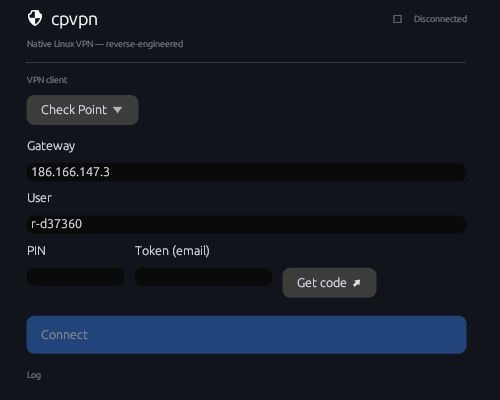

<div align="center">


# cpvpn

**A native Linux VPN client — reverse-engineered, no vendor binaries.**

Check Point *Endpoint Connect / Trac*, **Fortinet FortiGate**, **F5 BIG-IP APM**
and **Cisco AnyConnect** SSL-VPNs today; OpenVPN planned. Pretty GUI, a real
system-tray icon, and a self-contained engine that runs on any distro.



</div>

---

## What this is

`cpvpn` speaks the Check Point VPN protocol **natively**, implemented from scratch in
Rust by reverse-engineering the wire protocol — it does **not** wrap or depend on the
proprietary `snx` / Endpoint Connect binaries. The whole control and data plane is ours:

- **CCC** control channel (Check Point S-expressions over TLS).
- **IKEv1 / IPsec** Main Mode with **hybrid auth** (gateway RSA cert) and
  **RSA SecurID** via ISAKMP config transactions.
- **Office Mode** (internal IP + DNS + domains), **Quick Mode**, and the
  **ESP data plane** (3DES/AES + HMAC-SHA) encapsulated in **UDP 4500 (NAT-T)**.

It is meant for **authorized interoperability** — connecting to a corporate VPN you are
entitled to use, from Linux, without a vendor client that ships Linux binaries late or not
at all.

## Features

- 🎨 **Clean native GUI** (egui) — VPN selector, gateway/user, PIN + emailed SecurID token,
  live status and log.
- 🛡 **System-tray icon** (StatusNotifierItem) that reflects connection state; the window
  hides to the tray instead of quitting. Falls back to a plain window where no tray exists.
- 🔒 **Safe privilege model** — the GUI runs as your user and launches the privileged engine
  via **pkexec**; the passcode is piped on stdin (never in `argv`/process list).
- 🌐 **DNS handling** — points `resolv.conf` at the corporate DNS + search domains while
  connected and restores it on disconnect (handles `systemd-resolved` symlinks).
- 📦 **Distro-agnostic** — the engine links OpenSSL **statically** (only needs glibc);
  routing uses `iproute2`, present everywhere.
- 🧰 **CLI too** — the `cpvpn` engine is a full command-line client on its own.

## Install

```sh
./install.sh            # builds both, installs to /usr/local (asks for sudo)
PREFIX=~/.local ./install.sh   # user-local, no root
./install.sh --uninstall
```

The installer builds the engine with static OpenSSL, installs `cpvpn` + `cpvpn-gui`, the
icons, a `.desktop` entry, and (optionally) a polkit rule so connecting prompts for the
admin password once and then caches it.

**Requirements:** Rust/cargo (build), `pkexec` (polkit), `iproute2`, a desktop with a
tray (optional). Build deps for static OpenSSL: a C compiler, `perl`, `make`.

### Manual build

```sh
cargo build --release --features vendored --manifest-path checkpoint-client/Cargo.toml
cargo build --release --manifest-path cpvpn-gui/Cargo.toml
```

## Usage

### GUI
Launch **cpvpn** from your app menu (or `cpvpn-gui`). Pick the VPN, confirm gateway/user,
hit **Get code ↗** to request your SecurID tokencode by email, enter **PIN + tokencode**,
and **Connect**. Closing the window keeps it running in the tray.

### CLI
```sh
# Check Point (prompts for the passcode on stdin, or pass --passcode):
sudo cpvpn ike -g 203.0.113.10 -u <user> --connect

# Fortinet FortiGate SSL-VPN:
cpvpn forti -g vpn.example.com:443 --probe                 # non-destructive detection
sudo cpvpn forti -g vpn.example.com -u <user> --connect    # password (+ OTP) on stdin
sudo cpvpn forti -g vpn.example.com --saml --connect       # SSO/SAML via the browser

# F5 BIG-IP APM SSL-VPN:
sudo cpvpn f5 -g vpn.example.com -u <user> --connect       # password (+ OTP) on stdin

# Cisco AnyConnect SSL-VPN (ASA / Secure Firewall):
cpvpn anyconnect -g https://vpn.example.com/GROUP --probe          # shows form/groups/SSO
sudo cpvpn anyconnect -g https://vpn.example.com -u <user> --connect   # password (+ 2FA) on stdin
```
Send `disconnect` on stdin (or SIGTERM) for a clean teardown.

## How it works

```
┌──────────────┐   pkexec (stdin: passcode / "disconnect")   ┌─────────────────────┐
│  cpvpn-gui   │ ─────────────────────────────────────────▶ │  cpvpn (root)       │
│  user · tray │ ◀───────────────  stdout: status  ───────── │  engine             │
└──────────────┘                                             │  IKE+ESP · tun · DNS│
                                                             └─────────────────────┘
```

- **`checkpoint-client/`** — the engine + CLI (protocol, crypto, tun, data plane).
- **`cpvpn-gui/`** — the GUI + tray (drives the engine as a subprocess).
- **`docs/protocol-notes.md`** — the reverse-engineering ledger.

### Maximum portability (optional)
For a single fully-static binary that runs even without a matching glibc, build the engine
for musl:
```sh
rustup target add x86_64-unknown-linux-musl
cargo build --release --features vendored --target x86_64-unknown-linux-musl \
    --manifest-path checkpoint-client/Cargo.toml
```

### Tiling WMs
On tiling compositors (Sway, Hyprland, i3…) the window fills its tile; the form stays a
neat centered column. To float it, e.g. on Sway:
```
for_window [app_id="cpvpn"] floating enable
```

## Status & roadmap

- [x] Check Point: full handshake + live tunnel (SecurID, Office Mode, ESP/NAT-T).
- [x] GUI + system tray, DNS, clean connect/disconnect, static/portable engine, installer.
- [x] ESP SA rekey — renegotiated with no re-auth, seamless hot-swap, keeps long sessions
      alive past the 1-hour SA lifetime. (DPD is not required by Check Point.)
- [x] **Fortinet FortiGate SSL-VPN** — password, FortiToken/OTP + push, **SAML/SSO**,
      in-process **PPP** (LCP/IPCP) data plane, split/full-tunnel routing, DNS, GUI selector.
      *(built + unit-tested; live-gateway verification pending.)* See
      [`docs/forti-protocol-notes.md`](docs/forti-protocol-notes.md).
- [x] **F5 BIG-IP APM SSL-VPN** — HTML-form login (+ OTP), webtop "Start"
      (`f5-vpn://`) handoff, in-process **PPP** data plane, split/full routing, DNS,
      keepalive + transparent reconnection, GUI selector. *(live-validated end-to-end.)*
      See [`docs/f5-protocol-notes.md`](docs/f5-protocol-notes.md).
- [x] **Cisco AnyConnect SSL-VPN** — aggregate-auth XML login (groups, challenge/2FA,
      partial SAML/SSO), **CSTP** data plane (STF framing), split/full routing, DNS,
      DPD/keepalive + transparent reconnection, GUI selector. *(control plane
      validated against a real ASA; successful login + data plane pending creds.)*
      See [`docs/anyconnect-protocol-notes.md`](docs/anyconnect-protocol-notes.md).
- [ ] Fortinet/AnyConnect DTLS acceleration (UDP) and Fortinet IPsec/IKEv2 mode.
- [ ] AnyConnect SSO via an embedded webview (token paste for now); OpenVPN back-end.

## Legal

For authorized use only. Use `cpvpn` solely to connect to VPNs you are permitted to access.
Interoperability through protocol reverse-engineering, done for compatibility, is broadly
protected — but you are responsible for complying with your organization's policies and
applicable law.
