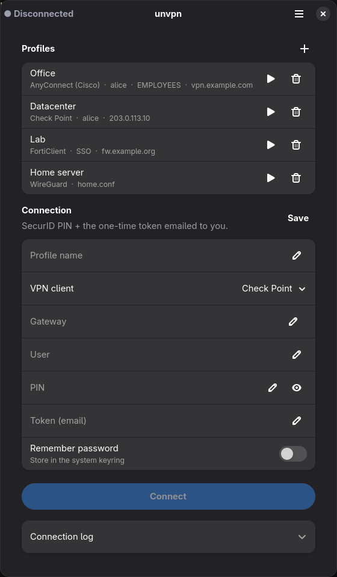

<div align="center">


# unvpn

A native Linux client for corporate VPNs, written in Rust.

</div>

Supported VPNs:

- Check Point
- Fortinet FortiGate SSL-VPN
- Fortinet FortiClient IPsec (IKEv2 + EAP)
- F5 BIG-IP APM
- Cisco AnyConnect
- Palo Alto GlobalProtect
- OpenVPN
- WireGuard

<p align="center">
  
</p>

## Features

- GTK4 app with saved connection profiles; passwords in the system keyring.
- Tray icon showing the connection state.
- Encrypted export / import of all profiles, to move them between machines.
- Auto-reconnect after sleep or a network change, without re-auth.
- Leak protection: optional kill switch and an IPv6 egress block.

## Install

Needs Rust, a C toolchain, GTK4, libadwaita, webkitgtk-6.0, polkit, iproute2 and
nftables. On Arch:

```sh
sudo pacman -S --needed rust base-devel perl gtk4 libadwaita webkitgtk-6.0 polkit iproute2 nftables
```

```sh
./install.sh                    # installs to /usr/local (asks for sudo)
PREFIX=~/.local ./install.sh    # or just for your user
./install.sh --uninstall
```

The installer can also add an autostart entry so unvpn starts in the tray at login.

## Command line

```sh
sudo unvpn ike -g 203.0.113.10 -u alice --connect                    # Check Point
sudo unvpn forti -g vpn.example.com -u alice --connect               # Fortinet
sudo unvpn forti -g vpn.example.com --saml --connect                 # Fortinet with SSO
sudo unvpn forti-ipsec -g vpn.example.com -u alice --connect         # Fortinet IPsec (FortiClient)
sudo unvpn f5 -g vpn.example.com -u alice --connect                  # F5
sudo unvpn anyconnect -g https://vpn.example.com -u alice --connect  # AnyConnect
sudo unvpn gp -g vpn.example.com -u alice --connect                  # GlobalProtect
sudo unvpn openvpn -c profile.ovpn --connect                         # OpenVPN
sudo unvpn wireguard -c wg0.conf --connect                           # WireGuard
```

`--killswitch` enables a fail-closed firewall; `--allow-ipv6` keeps IPv6 instead of blocking it.

## Legal

Only use unvpn to connect to VPNs you are allowed to use.
