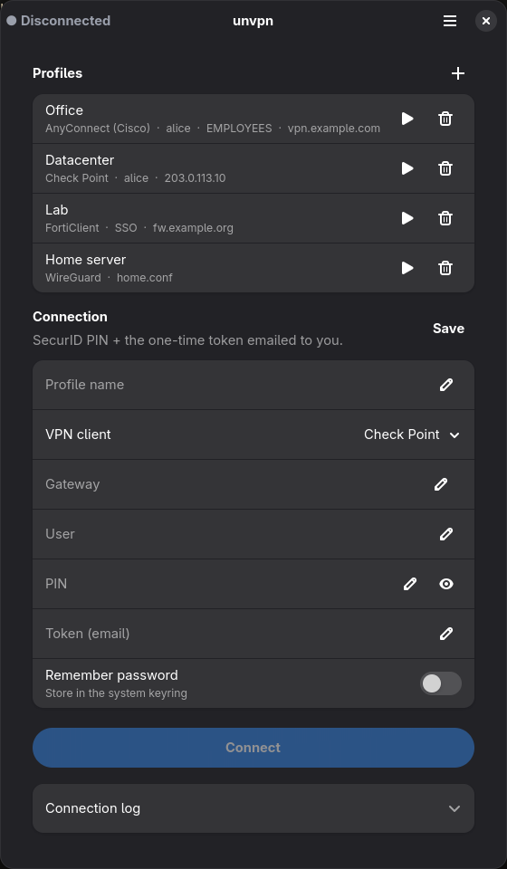

<div align="center">


# unvpn

A native Linux client for corporate VPNs written in Rust.

</div>

Supported VPNs:

- Check Point
- Fortinet FortiGate SSL-VPN
- F5 BIG-IP APM
- Cisco AnyConnect
- Palo Alto GlobalProtect
- OpenVPN
- WireGuard

<p align="center">
  
</p>

## Features

- GTK4 / libadwaita app with saved connection profiles.
- Passwords are stored in the system keyring.
- Tray icon that shows the connection state.

## Install

Build dependencies:

- Rust and cargo.
- A C compiler, `perl` and `make`.
- GTK4 and libadwaita.
- `webkitgtk-6.0` (for the built-in SSO sign-in window).

Runtime dependencies:

- `pkexec` (polkit).
- `iproute2`.
- A system tray, like Waybar's or GNOME's AppIndicator extension (optional).

On Arch:

```sh
sudo pacman -S --needed rust base-devel perl gtk4 libadwaita webkitgtk-6.0 polkit iproute2
```

Then:

```sh
./install.sh                    # installs to /usr/local (asks for sudo)
PREFIX=~/.local ./install.sh    # or just for your user
./install.sh --uninstall
```

## Using the app

Open **unvpn** from your app menu. Pick the VPN type, fill in the gateway and user, and
click **Save** to keep it as a profile. Next time, click the play button next to the
profile to connect.

## Command line

```sh
sudo unvpn ike -g 203.0.113.10 -u alice --connect                    # Check Point
sudo unvpn forti -g vpn.example.com -u alice --connect               # Fortinet
sudo unvpn forti -g vpn.example.com --saml --connect                 # Fortinet with SSO
sudo unvpn f5 -g vpn.example.com -u alice --connect                  # F5
sudo unvpn anyconnect -g https://vpn.example.com -u alice --connect  # AnyConnect
sudo unvpn gp -g vpn.example.com -u alice --connect                  # GlobalProtect
sudo unvpn openvpn -c profile.ovpn --connect                         # OpenVPN
sudo unvpn wireguard -c wg0.conf --connect                           # WireGuard
```

Passwords and codes are read from stdin. Type `disconnect` or press Ctrl+C to close the
tunnel cleanly. Most VPN types also have `--probe`, which checks the gateway without
logging in. Run `unvpn` with no arguments to see all options.

## Legal

Only use unvpn to connect to VPNs you are allowed to use.
